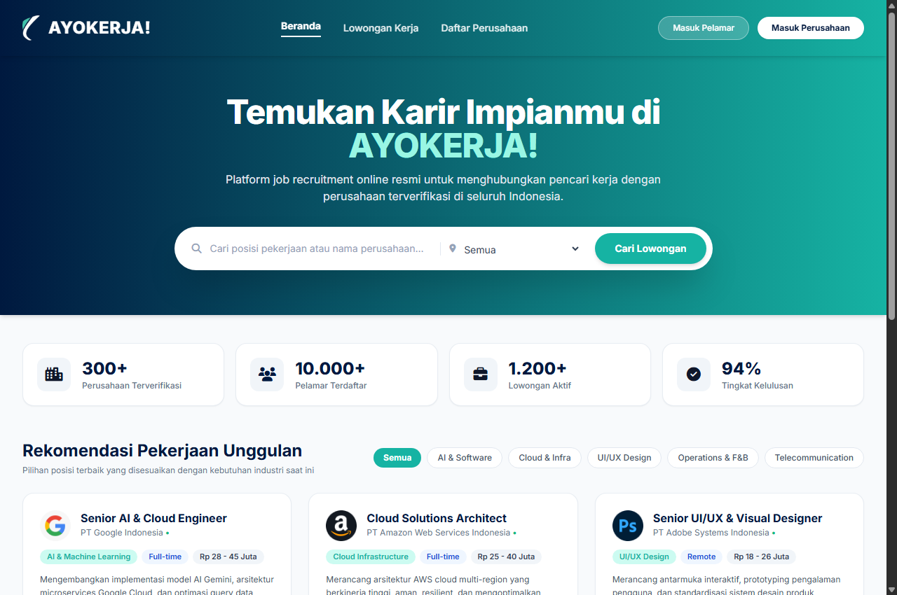
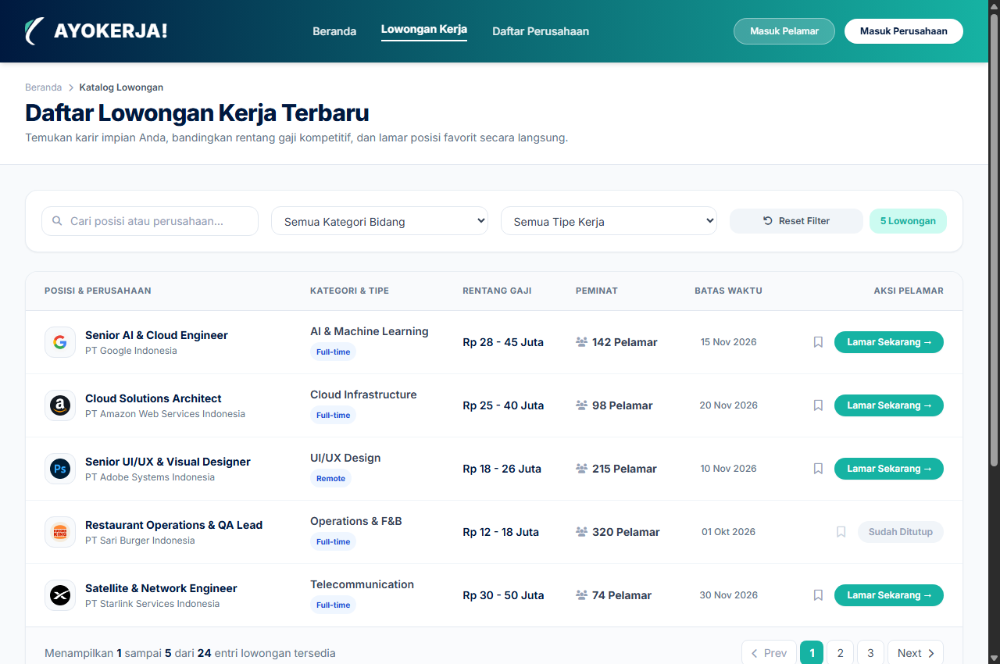
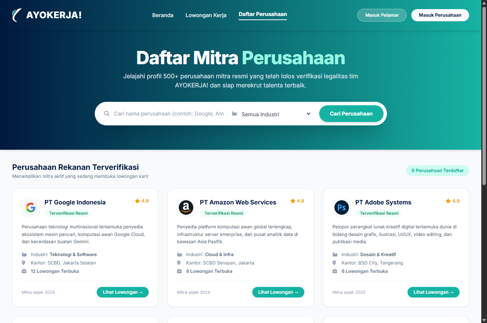
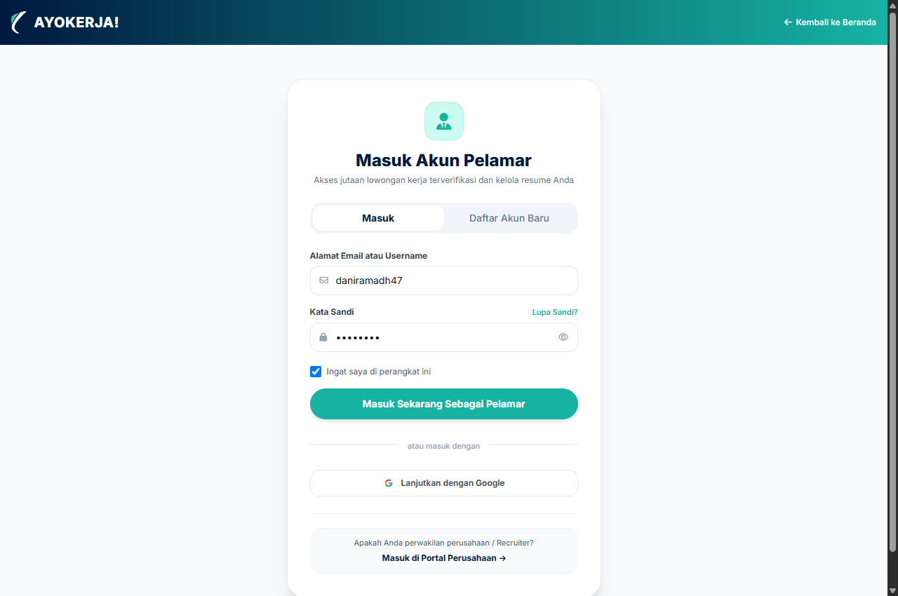
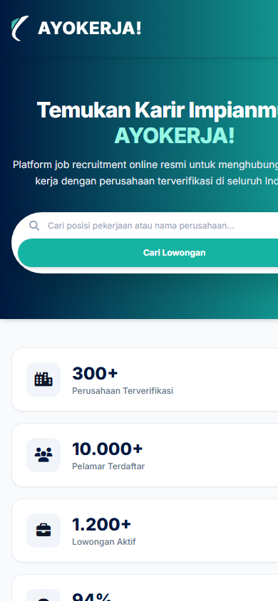
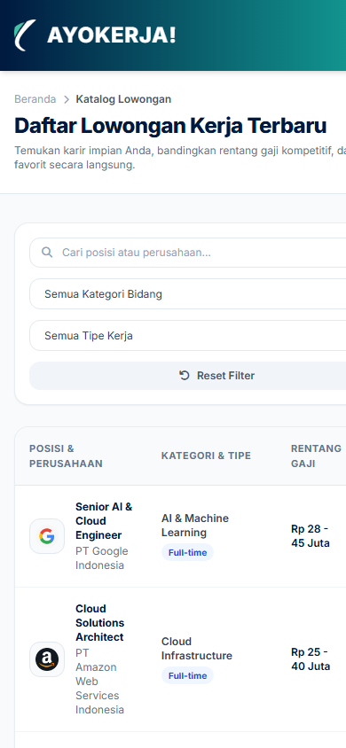
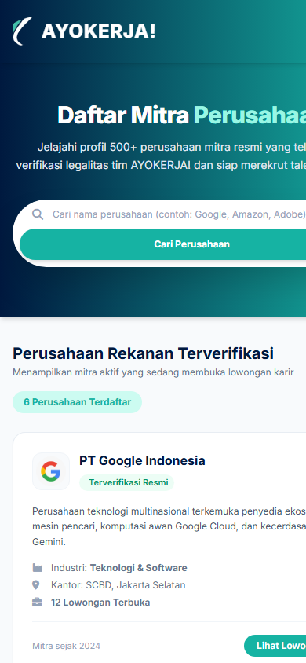
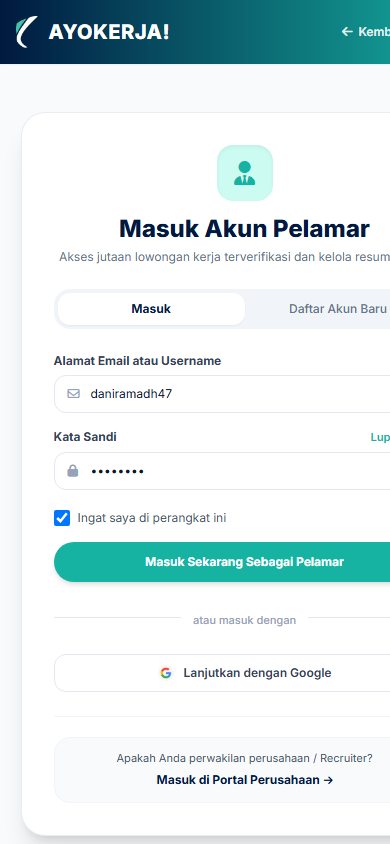

# Dokumentasi Tugas Pemrograman Web
## BAB REACT DASAR — Frontend Skeleton (Tailwind CSS)

**Nama Mahasiswa / Repositori:** tugasWEBPRO  
**Studi Kasus Proyek Fullstack:** **AYOKERJA!** (Portal Rekrutmen & Penyaluran Kerja Terpadu Indonesia)  
**Tautan Repositori GitHub:** [https://github.com/hydenn11/tugasWEBPRO](https://github.com/hydenn11/tugasWEBPRO)  
**CSS Framework Terpilih:** **Tailwind CSS**

---

## 1. Deskripsi & Arsitektur Peran Pengguna
Pada revisi tahap ini, antarmuka portal **AYOKERJA!** dibangun dengan membedakan secara tegas antara dua sisi entitas pengguna:
1. **Sisi Pelamar / Pencari Kerja (*Job Seeker*)**:
   - Menjelajahi katalog lowongan kerja, menggunakan filter pencarian multi-kategori, dan masuk melalui portal **Masuk Pelamar** (`login-pelamar.html`).
2. **Sisi Mitra Perusahaan (*Employer / Recruiter*)**:
   - Memiliki alur registrasi dan otentikasi mandiri di **Masuk Perusahaan** (`login-perusahaan.html`), yang kemudian memberikan akses ke halaman khusus **Dashboard & Pasang Lowongan Perusahaan** (`dashboard-perusahaan.html`).
3. **Katalog & Pencarian Mitra Perusahaan (`daftar-perusahaan.html`)**:
   - Menggantikan halaman tambah lowongan publik menjadi pusat eksplorasi profil perusahaan mitra terverifikasi lengkap dengan **fitur pencarian instan (*search input*)** dan filter industri.

---

## 2. Alasan Pemilihan Tailwind CSS
1. **Konsistensi Desain Tanpa Kompromi (*Utility-First*)**:
   Tailwind CSS memungkinkan penerapan palet warna khusus (`brand.navy`, `brand.teal`), gradien navbar, dan komponen bentuk kapsul (*pill*) secara presisi sesuai prototipe Bab 3 tanpa terikat batasan komponen bawaan framework seperti Bootstrap.
2. **Kesiapan Menuju Ekosistem React Component**:
   Struktur kelas utilitas Tailwind siap didekomposisi langsung menjadi komponen modular React (`<Navbar />`, `<CompanyCard />`, `<JobTable />`, `<AuthCard />`) pada pekan perkuliahan berikutnya.
3. **Responsivitas Teruji (*Mobile-First Breakpoints*)**:
   Transisi dari tampilan desktop multi-kolom ke tampilan mobile drawer dapat diatur secara deklaratif menggunakan breakpoint `sm:`, `md:`, dan `lg:`.

---

## 3. Fitur & Halaman yang Dibangun

| No | Halaman | Berkas | Peran & Fitur Antarmuka |
| :---: | :--- | :--- | :--- |
| 1 | **Beranda Utama** | [`index.html`](./index.html) | • Navbar gradien navy-teal persis Bab 3 dengan tombol *Masuk Pelamar* & *Masuk Perusahaan*.<br>• Hero Banner dengan Clean Pill Search Bar kapsul.<br>• 4 Kartu Statistik Ekosistem.<br>• Grid 6 Rekomendasi Lowongan Kerja Unggulan dengan badge kategori, gaji, dan tombol lamar. |
| 2 | **Lowongan Kerja** | [`jobs.html`](./jobs.html) | • Tabel data lowongan kerja responsif (*horizontal scroll* pada mobile).<br>• Filter bar pencarian posisi dan kategori industri.<br>• Kolom identitas posisi, logo perusahaan, rentang kompensasi, peminat/pelamar, batas waktu, dan aksi pelamar. |
| 3 | **Daftar Perusahaan** | [`daftar-perusahaan.html`](./daftar-perusahaan.html) | • **Fitur Pencarian Perusahaan (*Live Search Input*)** dan filter dropdown bidang industri.<br>• Grid profil mitra perusahaan terverifikasi (Google, Amazon, Adobe, SpaceX, Burger King).<br>• Informasi kuota lowongan aktif dan rating perusahaan. |
| 4 | **Profil Pelamar** | [`profile-pelamar.html`](./profile-pelamar.html) | • Foto profil avatar dengan fitur unggah/ganti foto langsung.<br>• Nama pelamar yang **bisa diedit** secara instan dengan modal interaktif.<br>• Informasi email, telepon, domisili, dan tautan jejaring LinkedIn.<br>• **Ringkasan Pribadi** profesional untuk memperkenalkan diri (dapat diedit).<br>• **Riwayat Karier** & pengalaman kerja terdahulu agar menonjol di mata perusahaan.<br>• Riwayat Pendidikan & IPK.<br>• Lisensi & Sertifikasi resmi.<br>• Badge Keahlian & Keterampilan teknis.<br>• Penguasaan Bahasa & tingkat kefasihan.<br>• Berkas Resume / CV untuk kemudahan akses lamaran (unduh & unggah berkas baru). |
| 5 | **Masuk & Daftar Pelamar** | [`login-pelamar.html`](./login-pelamar.html) | • Formulir autentikasi pencari kerja dengan tab *Masuk* & *Daftar Akun Baru*.<br>• Saat berhasil masuk/daftar, tombol *Masuk Pelamar* otomatis berganti menjadi **Dropdown Profil Pelamar** (`daniramadh47`) yang memuat akses cepat ke: Buka Profil Saya, Lowongan Tersimpan (status terkunci), Riwayat Lamaran Kerja (status terkunci), **Pengaturan Akun (Edit/Ubah Email & Hapus Akun)**, dan Keluar. |
| 6 | **Masuk Perusahaan** | [`login-perusahaan.html`](./login-perusahaan.html) | • Portal khusus recruiter: Tab ganti *Masuk Perusahaan* & *Daftar Perusahaan Baru* terverifikasi. |

---

## 4. Struktur Direktori Proyek

```text
Tugas_React_dasar/
├── assets/                               # Aset logo, icon mitra, & script autentikasi
│   ├── company-adobe.png
│   ├── company-amazon.png
│   ├── company-burgerking.png
│   ├── company-google.png
│   ├── company-spacex.png
│   ├── logo.png
│   └── pelamar-auth.js                   # Manajemen sesi login & dropdown profil pelamar
├── docs/
│   └── screenshots/                      # Tangkapan layar bukti responsive
├── index.html                            # Beranda Utama (Pelamar & Umum)
├── jobs.html                             # Tabel & Daftar Lowongan Kerja
├── daftar-perusahaan.html                # Katalog & Search Mitra Perusahaan
├── profile-pelamar.html                  # Halaman Profil Lengkap Pelamar
├── login-pelamar.html                    # Form Login & Registrasi Pelamar
├── login-perusahaan.html                 # Form Login & Daftar Mitra Perusahaan
├── dashboard-perusahaan.html             # Halaman Khusus Perusahaan (Pasang Lowongan)
└── README.md                             # Dokumentasi Tugas
```

---

## 5. Tangkapan Layar Halaman (Screenshots)

### A. Tampilan Desktop

#### 1. Halaman Beranda (`index.html`)


#### 2. Halaman Lowongan Kerja (`jobs.html`)


#### 3. Halaman Daftar Perusahaan (`daftar-perusahaan.html`)


#### 4. Halaman Masuk & Daftar Pelamar (`login-pelamar.html`)


---

### B. Tampilan Mobile

#### 1. Halaman Beranda Mobile (`index.html`)


#### 2. Halaman Lowongan Kerja Mobile (`jobs.html`)


#### 3. Halaman Daftar Perusahaan Mobile (`daftar-perusahaan.html`)


#### 4. Halaman Masuk & Daftar Pelamar Mobile (`login-pelamar.html`)


